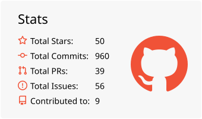
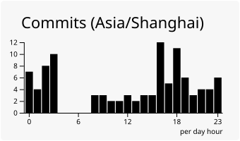

<div align="center">
 
 

</div>

<div align="center">  </div>

### Hi there 👋

<!--
this is a ✨ _special_ ✨ repository because its `README.md` (this file) appears on your GitHub profile.

Here are some ideas to get you started:

- 🔭 I’m currently working on ...
- 🌱 I’m currently learning ...
- 👯 I’m looking to collaborate on ...
- 🤔 I’m looking for help with ...
- 💬 Ask me about ...
- 📫 How to reach me: ...
- 😄 Pronouns: ...
- ⚡ Fun fact: ...
-->

<!--START_SECTION:waka-->


**🐱 My GitHub Data** 

> 📦 282.3 kB Used in GitHub's Storage 
 > 
> 🏆 110 Contributions in the Year 2026
 > 
> 🚫 Not Opted to Hire
 > 
> 📜 47 Public Repositories 
 > 
> 🔑 11 Private Repositories 
 > 
📅 **I'm Most Productive on Tuesday** 

```text
Monday                   391 commits         ████░░░░░░░░░░░░░░░░░░░░░   15.14 % 
Tuesday                  491 commits         █████░░░░░░░░░░░░░░░░░░░░   19.01 % 
Wednesday                473 commits         █████░░░░░░░░░░░░░░░░░░░░   18.31 % 
Thursday                 218 commits         ██░░░░░░░░░░░░░░░░░░░░░░░   08.44 % 
Friday                   313 commits         ███░░░░░░░░░░░░░░░░░░░░░░   12.12 % 
Saturday                 379 commits         ████░░░░░░░░░░░░░░░░░░░░░   14.67 % 
Sunday                   318 commits         ███░░░░░░░░░░░░░░░░░░░░░░   12.31 % 
```


📊 **This Week I Spent My Time On** 

```text
🕑︎ Time Zone: Asia/Shanghai

💬 Programming Languages: 
No Activity Tracked This Week

🔥 Editors: 
No Activity Tracked This Week

💻 Operating System: 
No Activity Tracked This Week
```

🤖 **AI Coding This Week** 

```text
No AI Coding Activity Tracked This Week
```

**I Mostly Code in C++** 

```text
C++                      10 repos            █████░░░░░░░░░░░░░░░░░░░░   20.41 % 
Go                       10 repos            █████░░░░░░░░░░░░░░░░░░░░   20.41 % 
Rust                     9 repos             █████░░░░░░░░░░░░░░░░░░░░   18.37 % 
C                        1 repo              █░░░░░░░░░░░░░░░░░░░░░░░░   02.04 % 
Typst                    1 repo              █░░░░░░░░░░░░░░░░░░░░░░░░   02.04 % 
```


 Last Updated on 08/11/2026 15:16:25 UTC
<!--END_SECTION:waka-->

GitHub language statistics: (public repositories only)
<div align="center">


</div>

My Github Profile Trophy's Ranking: 
<div align="center">  </div>


